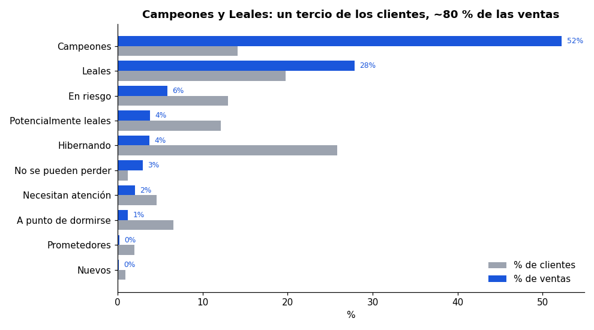
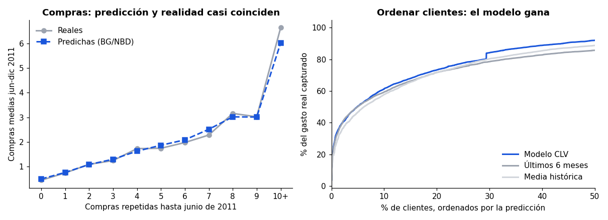
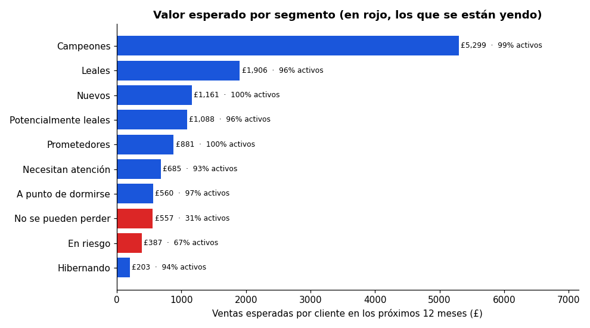
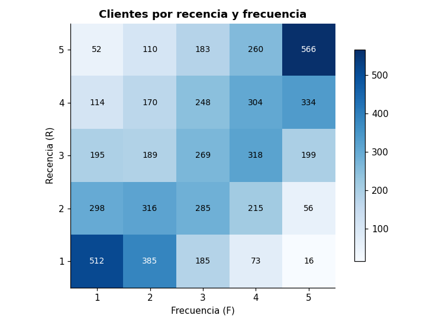

# Segmentación de clientes (RFM) y valor de vida (CLV)

**Quiénes son los mejores clientes de una tienda online, quiénes se están yendo y cuánto valdrá cada uno el próximo año. Datos reales: 776.000 líneas de venta y 5.852 clientes.**

[](https://github.com/alvarodc093-pixel/Customer-Segmentation-RFM/actions/workflows/ci.yml)    



## En resumen

- **Problema:** una tienda online de regalos (Reino Unido, con mucha venta a comercios) quiere repartir mejor su presupuesto de marketing: a quién cuidar, a quién recuperar y en quién no gastar.
- **Datos:** [Online Retail II](https://archive.ics.uci.edu/dataset/502/online+retail+ii) (UCI, CC BY 4.0), con todas las facturas de diciembre de 2009 a diciembre de 2011.
- **Métodos:** limpieza documentada, **segmentación RFM** en 10 segmentos con una acción para cada uno, y **CLV con BG/NBD + Gamma-Gamma**. Los dos modelos están programados con scipy y validados con 6 meses que el modelo no vio.
- **Resultado:** el **20 % de los clientes genera el 77 % de las ventas**. Campeones y Leales (un tercio de los clientes) concentran el 80 % de las ventas y el 77 % del valor futuro. Hay una lista de **830 clientes en riesgo** con 333.000 £ de ventas esperadas, y los 100 primeros suman 118.000 £.

## Hallazgos principales

| # | Pregunta | Respuesta |
|---|---|---|
| 1 | ¿Cuánto dependen las ventas de pocos clientes? | Mucho: el 20 % genera el **77 %** de las ventas, y el 1 % genera el 32 %. |
| 2 | ¿Quiénes son los mejores? | **Campeones** (14 % de clientes, 52 % de las ventas: compraron hace 9 días de mediana y 19 veces de media) y **Leales** (20 % de clientes, 28 % de las ventas). |
| 3 | ¿Quién se está yendo? | **En riesgo** (758 clientes, sin comprar desde hace un año de mediana) y **No se pueden perder** (72 clientes que compraban 16 veces y llevan 10 meses sin volver). |
| 4 | ¿Cuánto valdrán el próximo año? | 8,55 M£ de ventas netas esperadas. Un Campeón vale de media **5.300 £**, un Leal 1.900 £ y un cliente Hibernando 200 £. |
| 5 | ¿Funciona el modelo de valor? | Predice las compras de los 6 meses siguientes con un **2 % de error**. Infravalora el gasto total (-19 %) porque en ese semestre subió el ticket medio. Para **ordenar** clientes es el mejor: su top 20 % concentra el **73 % del gasto real**. |



## Recomendaciones

| Segmento | Clientes | Qué hacer |
|---|---|---|
| Campeones | 826 | Cuidarlos por encima de todo: atención personal, condiciones preferentes, acceso anticipado. |
| Leales | 1.155 | Venta cruzada y de más valor. |
| En riesgo / No se pueden perder | 830 | Campaña de recuperación **por orden de valor esperado**, empezando por los 100 primeros. |
| Nuevos / Prometedores | 166 | Incentivo para la segunda compra, que es el gran salto. |
| Hibernando | 1.511 | Solo reactivación barata por email; no invertir más si no responden. |



## Cómo funciona

### 1. Limpieza

| Paso | Filas | Quitadas |
|---|---:|---:|
| Filas originales | 1.067.371 | |
| Sin duplicados (las dos hojas del Excel se solapan en diciembre de 2010) | 1.033.036 | 34.335 |
| Con cliente identificado | 797.885 | 235.151 |
| Solo productos (sin portes, comisiones de Amazon, ajustes ni vales) | 794.223 | 3.662 |
| Ventas válidas (sin devoluciones ni cantidades o precios ≤ 0) | 776.577 | 17.646 |

Las devoluciones (4,2 % de lo vendido) se guardan aparte y se restan del importe de cada cliente.

### 2. RFM

Cada cliente recibe una puntuación de 1 a 5 en **R**ecencia, **F**recuencia e i**M**porte según su quintil. Como muchos clientes tienen una sola compra, los quintiles se calculan sobre el ranking para que cada puntuación tenga el 20 % de los clientes. La combinación de R y F da 10 segmentos clásicos (Campeones, Leales, En riesgo, Hibernando…).



### 3. CLV con BG/NBD + Gamma-Gamma

- **BG/NBD** (Fader, Hardie y Lee, 2005): cada cliente compra a su propio ritmo hasta que, sin avisar, deja de ser cliente. Con tres datos de cada uno (cuántas veces repitió, cuándo fue la última vez y desde cuándo es cliente) estima sus **compras futuras** y la **probabilidad de que siga activo**.
- **Gamma-Gamma:** estima el **importe medio por compra**. Combina la media del cliente con la de todos, y fía más de la del cliente cuantas más compras tiene. Asume que el importe no depende de la frecuencia; aquí se cumple (correlación 0,08).
- **CLV a 12 meses** = compras esperadas × importe esperado × (1 − tasa de devolución del cliente).

Programé las verosimilitudes y las fórmulas de predicción con scipy (`gammaln`, `hyp2f1`), sin depender de `lifetimes`, que está abandonada. Los tests **simulan clientes con parámetros conocidos** y comprueban que los modelos los recuperan y predicen bien las compras futuras.

**Validación honesta.** Entrené con los datos hasta el 9 de junio de 2011 y predije los 6 meses siguientes:

| Predicción del gasto de jun-dic 2011 | Error medio por cliente | Correlación de orden | Gasto real capturado por su top 20 % |
|---|---:|---:|---:|
| **Modelo CLV** | **608 £** | **0,63** | **73 %** |
| Lo que gastó en los últimos 6 meses | 613 £ | 0,57 | 72 % |
| Su media histórica | 901 £ | 0,58 | 72 % |

### Dos trampas que el análisis evita

- **Devoluciones:** el cliente 12346 compró 74.215 unidades de un artículo por 77.000 £ y lo devolvió todo. Sin descontar devoluciones, el modelo lo valoraba en 28.600 £; con el ajuste, en 63 £.
- **Clientes de una sola compra:** el BG/NBD los considera activos por definición, así que «Hibernando» sale con un 94 % de activos. Para ellos hay que mirar el valor esperado (~200 £), no la probabilidad.

## Cómo está montado

```text
.
├── analisis.ipynb      # el análisis completo, ejecutado
├── rfm/
│   ├── limpieza.py     # descarga, limpieza documentada y transacciones por día
│   ├── segmentos.py    # tabla RFM, quintiles, segmentos y acciones
│   └── clv.py          # BG/NBD, Gamma-Gamma, CLV y simulador para tests
├── tests/              # 14 tests: limpieza y RFM con datos a mano, modelos con datos simulados
└── docs/img/
```

```bash
pip install -r requirements.txt
pytest -q
jupyter notebook analisis.ipynb    # descarga los datos de la UCI la primera vez (45 MB)
```

El CI ejecuta los tests y el notebook completo con los datos reales en cada push.

## Limitaciones

- El CLV está en **ventas, no en margen**, porque no hay costes.
- Muchos clientes son **mayoristas**, con valores por cliente de miles de libras.
- Solo hay dos años de datos y **una sola Navidad** para validar.
- El modelo supone que cada cliente mantiene su gasto por compra; si el ticket medio sube, infravalora el total.
- Los segmentos RFM son **relativos** (quintiles): cambian si cambia la base de clientes.

## English summary

Customer segmentation and lifetime value on Online Retail II (UCI, 776k sales lines, 5,852 customers). RFM scoring with rank-based quintiles produces 10 named segments, each with an action. BG/NBD and Gamma-Gamma are implemented from scratch with scipy and checked in tests against simulated customers with known parameters. In a 6-month holdout the model predicts purchases within 2 %, underestimates revenue by 19 % because the average basket grew, and ranks customers best: its predicted top 20 % captures 73 % of real spend. CLV is adjusted for each customer's return rate. Key findings: 20 % of customers generate 77 % of sales, and a prioritised list of 830 at-risk customers is worth £333k in expected sales.
